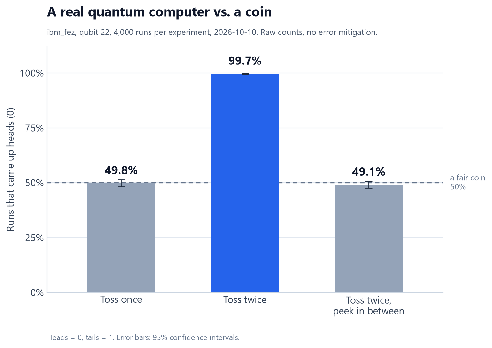

# What a coin can't do: the code

This folder has the code behind the first post in my series, *What a coin can't do*. I ran it on a real IBM quantum computer, ibm_fez, on 10 October 2026.



## What does it test?

We all know what happens when you flip a coin twice. Each flip is still 50/50, heads or tails. So I asked: does a qubit act the same way?

I ran three tiny experiments on one qubit, 4,000 times each. Heads is 0 and tails is 1. H is the quantum version of a coin toss.

| Experiment | Steps | A coin gives | My qubit gave |
|---|---|---|---|
| Toss once | H, look | 50% heads | 49.8% heads |
| Toss twice | H, H, look | 50% heads | 99.7% heads |
| Toss, peek, toss | H, look, H, look | 50% heads | 49.1% heads |

Two H's in a row cancel out, so the qubit comes back to heads. A peek in the middle breaks the cancelling. The post explains why, with pictures.

## What's in this folder?

| File | What it is |
|---|---|
| `qubit_vs_coin_simple.py` | The short version from the post, under 100 lines. Start here. |
| `qubit_vs_coin.py` | The full script I ran. It's about 800 lines, mostly safety checks. |
| `my-results/` | My raw results from ibm_fez. Its README explains each file. |

## How do I run it on my computer?

First set up Python as shown in the [main README](../README.md). Then run this from this folder:

```bash
python qubit_vs_coin_simple.py
```

That runs a perfect simulator on your own computer. You don't need an account. You should see this:

```text
Toss once          heads  50.0%
Toss twice         heads 100.0%
Toss, peek, toss   heads  50.8%
```

If toss twice shows 100% heads, your setup works.

## How do I run it on a real quantum computer?

1. Make a free IBM Quantum account at [quantum.cloud.ibm.com](https://quantum.cloud.ibm.com). Choose the Open Plan and create an API key.
2. Save your key and test everything without using any hardware time:

   ```bash
   python qubit_vs_coin.py --dry-run
   ```

   The first time, it asks for your API key. It saves the key in your user folder, not in this folder.
3. Now run one of the scripts for real. The short one prints the three results. The full one also saves them and draws the chart.

   ```bash
   python qubit_vs_coin_simple.py --ibm
   python qubit_vs_coin.py
   ```

Each run takes a few seconds of your 10 free minutes. Mine took 5 seconds.

Never paste your API key into a script you share. It works like a password.

## What does the full script add?

- It runs the experiments on a simulator first and checks the answers against the math.
- It picks the qubit with the lowest combined error for looking and for pulses.
- It checks that the compiler kept both H gates in toss twice.
- It saves the job ID. You can close the window and collect the result later.
- It saves the numbers and a chart in a `results` folder.

You can add these options:

| Option | What it does |
|---|---|
| `--dry-run` | Every check, including logging in and compiling for the chip. Nothing is sent to run. |
| `--backend ibm_fez` | Uses the machine you name instead of the least busy one. |
| `--login` | Asks for a new API key. |
| `--new` | Starts a fresh run. Older results move to `results_archive`. |
| `--yes` | Submits without asking, even after a warning. |

The script sometimes says "paste the same block again". I ran it from a PowerShell block on Windows. For you, that just means running the same command again.

## Why are my numbers a little different?

They will be, and that's fine. Each run is random, like real coin flips. You'll probably get a different machine and qubit too. Toss twice should still land near 100% heads. The other two should land near 50%.
