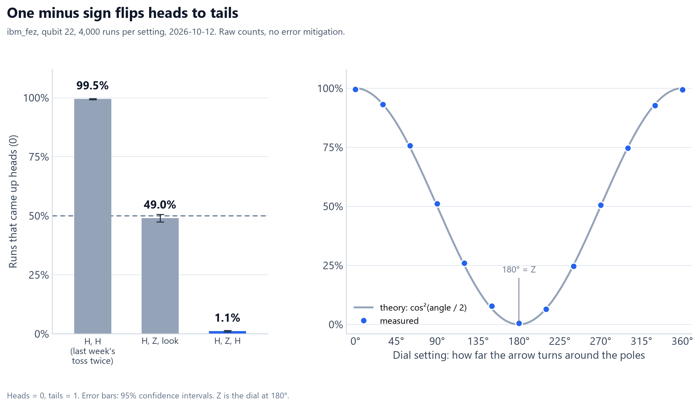

# The minus sign you can't see: the code

This folder has the code behind the second post in my series, *The minus sign you can't see*. I ran it on a real IBM quantum computer, ibm_fez, on 11 October 2026.



## What does it test?

Last week, two H gates in a row brought a qubit back to heads. This week I put one more step between them: Z, half a turn around the poles. On its own, Z changes nothing you can see. Between two H gates, it flips the answer.

| Experiment | Steps | Prediction | My qubit gave |
|---|---|---|---|
| Spin, then look | H, Z, look | 50% heads | 49.0% heads |
| Spin between two tosses | H, Z, H, look | 0% heads | 1.1% heads (98.9% tails) |
| The dial, 13 settings | H, turn by an angle, H, look | 100% heads down to 0% and back | within 1.2 points of the prediction every time |

The post explains why, with pictures.

## What's in this folder?

| File | What it is |
|---|---|
| `the_minus_sign_simple.py` | The short version from the post. Start here. |
| `the_minus_sign.py` | The full script I ran, with all its safety checks. |
| `my-results/` | My raw results from ibm_fez. Its README explains each file. |

## How do I run it on my computer?

First set up Python as shown in the [main README](../README.md). Then run this from this folder:

```bash
python the_minus_sign_simple.py
```

That runs a perfect simulator on your own computer. You don't need an account. The first two lines should say:

```text
Spin, then look      heads  50.0%
Spin between tosses  heads   0.0%
```

## How do I run it on a real quantum computer?

The steps are the same as in [last week's folder](../01-qubit-vs-coin/README.md):

1. Make a free IBM Quantum account at [quantum.cloud.ibm.com](https://quantum.cloud.ibm.com) and create an API key.
2. Test everything without using any hardware time:

   ```bash
   python the_minus_sign.py --dry-run
   ```

3. Run one of the scripts for real:

   ```bash
   python the_minus_sign_simple.py --ibm
   python the_minus_sign.py
   ```

The full run sends 15 circuits of 4,000 shots each. Mine used 18 seconds of my 10 free minutes.

Never paste your API key into a script you share. It works like a password.

## What does the full script add?

- It checks every circuit on a simulator first, against the math.
- It checks that the compiler kept both H pulses in every two-toss circuit.
- It works out each compiled circuit's answer on paper, to make sure compiling didn't change it.
- It can use the qubit you ask for, but only if that qubit beats the chip's median that day.
- It saves the job ID, so you can close the window and collect the result later.

You can add these options:

| Option | What it does |
|---|---|
| `--dry-run` | Every check, including logging in and compiling for the chip. Nothing is sent to run. |
| `--backend ibm_fez` | Uses the machine you name instead of the least busy one. |
| `--qubit 22` | Prefers this qubit, if it beats the chip's median that day. |
| `--login` | Asks for a new API key. |
| `--new` | Starts a fresh run. Older results move to `results_archive`. |
| `--yes` | Submits without asking, even after a warning. |

I ran it with `--backend ibm_fez --qubit 22`, the same machine and qubit as last week.

## Why are my numbers a little different?

They will be, and that's fine. Each run is random, and every qubit has its own errors. Spin, then look should land near 50% heads. Spin between two tosses should land near 100% tails.
