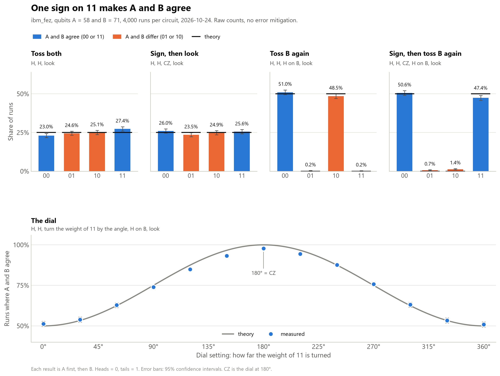

# Why do two qubits need four numbers? The code

This folder has the code behind the third Quantum Basics post, *Why do two qubits need four numbers?* I ran it on a real IBM quantum computer, ibm_fez, on 24 October 2026.



## What does it test?

Two qubits, A and B, have four possible results: 00, 01, 10 and 11. I always write A first. Each result gets its own weight.

This time I put a minus sign on the weight of 11 only, with a gate called CZ. A look can't see it. But toss B a second time, and B starts matching A.

| Experiment | Steps | Prediction | My qubits gave |
|---|---|---|---|
| Toss both | H on A and B, look | 25% for each result | 23.0% to 27.4% |
| Sign, then look | H on both, CZ, look | 25% for each result | 23.5% to 26.0% |
| Toss B again | H on both, H on B, look | 00 and 10, 50% each | 51.0% and 48.5% |
| Sign, then toss B again | H on both, CZ, H on B, look | 00 and 11, 50% each | 50.6% and 47.4%, so A and B agreed 98.0% of the time |
| The dial, 13 settings | H on both, turn the weight of 11, H on B, look | agreement from 50% up to 100% and back | within 3.4 points of the prediction every time |

The post explains why, with pictures.

## What's in this folder?

| File | What it is |
|---|---|
| `four_numbers_simple.py` | The short version from the post. Start here. |
| `four_numbers.py` | The full script I ran, with all its safety checks. |
| `my-results/` | My raw results from ibm_fez. Its README explains each file. |

## How do I run it on my computer?

First set up Python as shown in the [main README](../README.md). Then run this from this folder:

```bash
python four_numbers_simple.py
```

That runs a perfect simulator on your own computer. You don't need an account. The top of its table should say:

```text
                       00     01     10     11   agree
Toss both           24.1%  25.6%  25.9%  24.4%   48.5%
Sign, then look     25.1%  25.2%  24.2%  25.5%   50.5%
Toss B again        49.3%   0.0%  50.7%   0.0%   49.3%
Sign, then toss B   50.8%   0.0%   0.0%  49.2%  100.0%
```

## Why is the order of the bits flipped?

Qiskit writes results with the last qubit first, so its `"01"` means A landed tails and B landed heads. Both scripts flip every result before printing, so A always comes first.

## How do I run it on a real quantum computer?

The steps are the same as in the [first folder](../01-qubit-vs-coin/README.md):

1. Make a free IBM Quantum account at [quantum.cloud.ibm.com](https://quantum.cloud.ibm.com) and create an API key.
2. Test everything without using any hardware time:

   ```bash
   python four_numbers.py --dry-run
   ```

3. Run one of the scripts for real:

   ```bash
   python four_numbers_simple.py --ibm
   python four_numbers.py
   ```

The full run sends 17 circuits of 4,000 shots each. Mine used 20 seconds of my 10 free minutes.

Never paste your API key into a script you share. It works like a password.

## What does the full script add?

- It checks every circuit on a simulator first, against the math.
- It picks a pair of qubits that are wired to each other, with small errors that day. It counts both readouts, the two-qubit pulse between them and the single-qubit pulses.
- It checks that the compiler kept B's two H gates apart, and kept every sign as a real two-qubit pulse.
- It works out each compiled circuit's answer on paper, to make sure compiling didn't change it. It also checks that A and B were read from the right qubits.
- It saves the job ID, so you can close the window and collect the result later.

You can add these options:

| Option | What it does |
|---|---|
| `--dry-run` | Every check, including logging in and compiling for the chip. Nothing is sent to run. |
| `--backend ibm_fez` | Uses the machine you name instead of the least busy one. If it isn't taking jobs, the script asks before using another one. |
| `--qubits 58 71` | Prefers this pair as A and B, if the two are wired together and beat the chip's median that day. |
| `--login` | Asks for a new API key. |
| `--new` | Starts a fresh run. Older results move to `results_archive`. |
| `--yes` | Submits without asking, even after a warning or a switch of machine. |

I ran it with `--backend ibm_fez`, the same machine as the last two posts. The script picked qubits 58 and 71.

## Why are my numbers a little different?

They will be, and that's fine. Each run is random, and every pair of qubits has its own errors. Toss both and Sign, then look should land near 25% for each result. Sign, then toss B again should show A and B agreeing in nearly every run.
